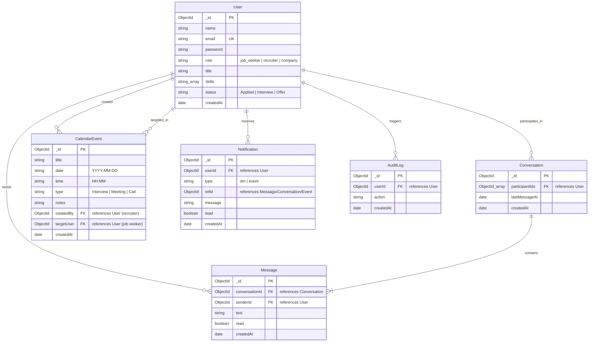

# Entity Relationship Document (ERD) — TalentBridge_V2

## 1. Database Architecture Overview
The database layer uses MongoDB via Mongoose. The model design favors clear relational integrity through ObjectId references while keeping schemas minimal and index-optimized.

---

## 2. Mermaid Entity Relationship Diagram

---

## 3. Schema Specifications & Field Constraints

### 3.1 `User` Collection
- `_id`: ObjectId (Primary Key)
- `name`: String, required, trimmed
- `email`: String, required, unique, lowercase, trimmed
- `password`: String, required (bcrypt hash, 10 salt rounds)
- `role`: String, enum: `['job_seeker', 'recruiter', 'company']`, required
- `title`: String, default: `''` (e.g. "Frontend Developer", "CEO")
- `skills`: Array of Strings (e.g. `['React', 'Node.js']`)
- `status`: String, enum: `['Applied', 'Interview', 'Offer']`, default: `'Applied'` (applies to job seekers)

### 3.2 `Conversation` Collection
- `_id`: ObjectId (Primary Key)
- `participantIds`: Array of ObjectIds (2 User IDs), indexed
- `lastMessageAt`: Date, default: `Date.now`, indexed for ordering

### 3.3 `Message` Collection
- `_id`: ObjectId (Primary Key)
- `conversationId`: ObjectId, ref: `Conversation`, required, indexed
- `senderId`: ObjectId, ref: `User`, required
- `text`: String, required, trimmed
- `read`: Boolean, default: `false`
- `createdAt`: Date, default: `Date.now`, indexed

### 3.4 `CalendarEvent` Collection
- `_id`: ObjectId (Primary Key)
- `title`: String, required
- `date`: String, format: `YYYY-MM-DD`, required, indexed
- `time`: String, format: `HH:MM`, required
- `type`: String, enum: `['Interview', 'Meeting', 'Call']`, required
- `notes`: String, default: `''`
- `createdBy`: ObjectId, ref: `User`, required (recruiter)
- `targetUser`: ObjectId, ref: `User`, required (job seeker), indexed
- `createdAt`: Date, default: `Date.now`

### 3.5 `Notification` Collection
- `_id`: ObjectId (Primary Key)
- `userId`: ObjectId, ref: `User`, required, indexed (recipient)
- `type`: String, enum: `['dm', 'event']`, required
- `refId`: ObjectId, required (ID of conversation or calendar event)
- `message`: String, required
- `read`: Boolean, default: `false`, indexed
- `createdAt`: Date, default: `Date.now`

### 3.6 `AuditLog` Collection
- `_id`: ObjectId (Primary Key)
- `userId`: ObjectId, ref: `User`, required
- `action`: String, required (e.g. "User Aarav Sharma (job_seeker) logged in")
- `createdAt`: Date, default: `Date.now`, indexed for chronological audit review

---

## 4. Query Optimization & Indexes
1. **User Authentication:** `email: 1` (unique)
2. **Conversations:** `participantIds: 1`, `lastMessageAt: -1`
3. **Messages:** `conversationId: 1, createdAt: 1`, `{ senderId: 1, read: 1 }`
4. **Events:** `targetUser: 1, date: 1`, `createdBy: 1`
5. **Notifications:** `userId: 1, read: 1, createdAt: -1`
6. **Audit Logs:** `createdAt: -1`
